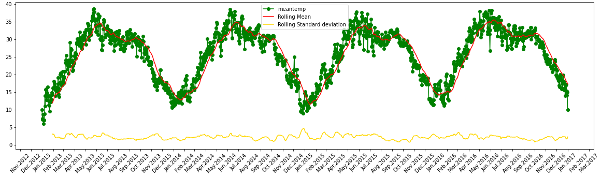
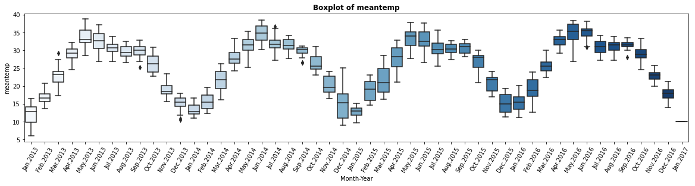
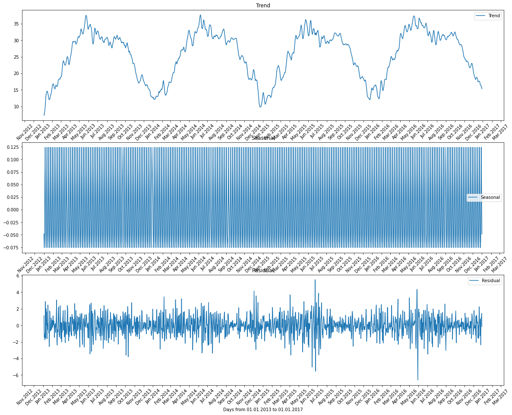
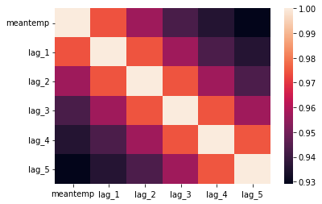
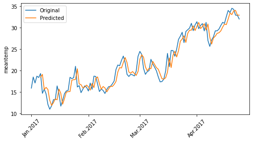
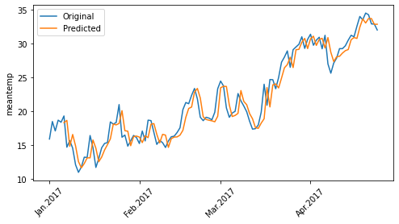
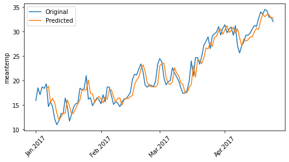
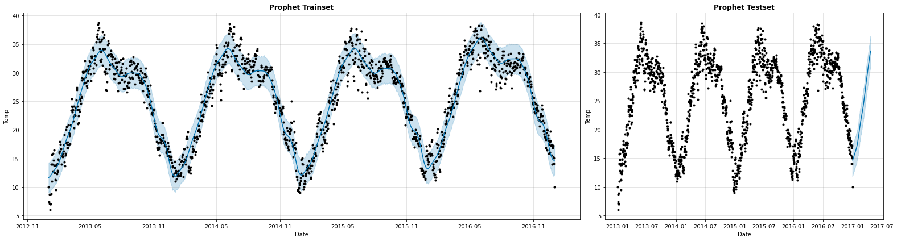
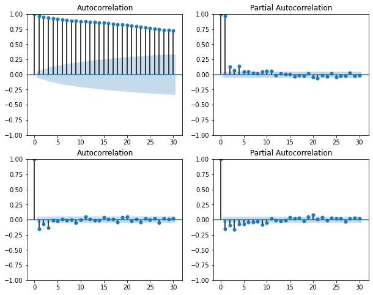
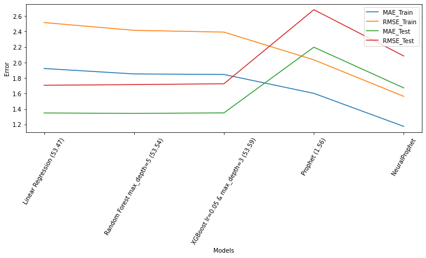

# ML-Models-for-Time-Series-Forecasting

Time series data is a sequence of data points indexed in time order and methods for predicting them are different than normal data. This project explores various feature engineering techniques and machine learning models to forecast the **mean temperature of Delhi** using a [Kaggle dataset](https://www.kaggle.com/datasets/sumanthvrao/daily-climate-time-series-data). The goal is to compare the performance of different models and feature engineering methods for time series forecasting.

## Dataset Overview

The dataset includes:
- **meantemp** (target variable)
- **humidity**
- **wind_speed**
- **meanpressure**
- **date**

The focus is on predicting **meantemp** using different feature engineering approaches.

---

## Exploratory Data Analysis (EDA)

Visualizations of the dataset:

Plotting the meantemp:







---

## Feature Engineering Methods

Three feature engineering techniques were applied:

### 1. Date Attributes
Extracting temporal features from dates:
```python
Trainset['month'] = pd.to_datetime(Train.index).month
Trainset['Week_n'] = pd.to_datetime(Train.index).isocalendar().week
Trainset['Day'] = pd.to_datetime(Train.index).day
```

### 2. Lag Features
Using past values (lags) to capture temporal dependencies:
```python
for inc in range(1, 6):
    field_name = f'lag_{inc}'
    Trainset[field_name] = Trainset['meantemp'].shift(inc)
    Testset[field_name] = Testset['meantemp'].shift(inc)
```

### 3. Rolling Window Statistics
Calculating rolling statistics (mean, max, min) over a 5-day window:
```python
rolling_mean = Trainset.rolling(window=5).mean()
rolling_max = Trainset.rolling(window=5).max()
rolling_min = Trainset.rolling(window=5).min()
Trainset[['rolling_mean', 'rolling_max', 'rolling_min']] = rolling_mean, rolling_max, rolling_min
```

---

## Models
1. Linear Regression
2. Random Forest
3. XGBoost
4. Prophet
5. SARIMA

E.g. using dataset created by the lags and scaled between -1 and 1, 3 models of linearRegression, RandomForrest, and XGBoost are trained and used to predict. 
|meantemp|	lag_1|	lag_2|	lag_3|	lag_4|	lag_5|
|:-------------:|:-------------:|:-------------:|:-------------:|:-------------:|:-------------:|
|	7.000000|	6.000000|	8.666667|	7.166667|	7.400000|	10.000000|
|	7.000000|	7.000000|	6.000000|	8.666667|	7.166667|	7.400000|
|	8.857143|	7.000000|	7.000000|	6.000000|	8.666667|	7.166667|
|	14.000000|	8.857143|	7.000000|	7.000000|	6.000000|	8.666667|
|   11.000000|	14.000000|	8.857143|	7.000000|	7.000000|	6.000000|

### Feature Correlation


---

## Model Implementation

```python
from sklearn.linear_model import LinearRegression
from sklearn.ensemble import RandomForestRegressor
from sklearn.preprocessing import MinMaxScaler
import xgboost as xgb
```

**LinearRegression()**



**RandomForestRegressor(max_depth=5)**



**xgb.XGBRegressor(objective='reg:squarederror', learning_rate=0.05, max_depth=3)**




For Prophet and NeuralProphet models, the dataframe must consist of two columns of y (target feature which is meantemp) and ds (date).
```python
from prophet import Prophet
```
```python
  df = Train[["meantemp"]] 
  df.rename(columns={"meantemp": "y"}, inplace=True)
  df['ds'] = pd.to_datetime(Train.index)
```  
**Prophet(weekly_seasonality=False, daily_seasonality=False)**



The Autoregressive Integrated Moving Average (ARMA(p, d, q)), model combines Autoregression (AR(p)) and Moving average (MA(q)) models with automatic differencing (d). Since meantemp is not stationary and by using one order of differencing, it becomes stationary, we can set d=1. Seasonality is important for forecasting if our data has one. Thus, seasonal autoregressive integrated moving-average (SARIMA(p, d, q)(P, D, Q)m) adds seasonal effects into the ARIMA model.  (P, D, Q) represent the seasonal orders and m is simply the number of observations per year. In this case, we have daily data, m=365. The ACF and PACF plots will help to have an estimate of these values. A helpful link for this purpose is https://arauto.readthedocs.io/en/latest/how_to_choose_terms.html. 
```python
from statsmodels.tsa.statespace.sarimax import SARIMAX
```
```python
  df = Train['meantemp']
  df.index = pd.DatetimeIndex(Train.index).to_period('D')
```
**model = SARIMAX(df['meantemp'], order=(1, 1, 3), seasonal_order=(1, 1, 1, <# observations in a year>)).fit()**



A drawback of using SARIMA here is as m=365, the runtime becomes very long!

---

## Result



### Key Insights
- **SARIMA** captures seasonality well but is computationally expensive due to daily data (`m=365`).
- **Prophet** and **XGBoost** perform robustly with minimal tuning.
- **Feature engineering** (lags, rolling stats) significantly impacts model performance.

